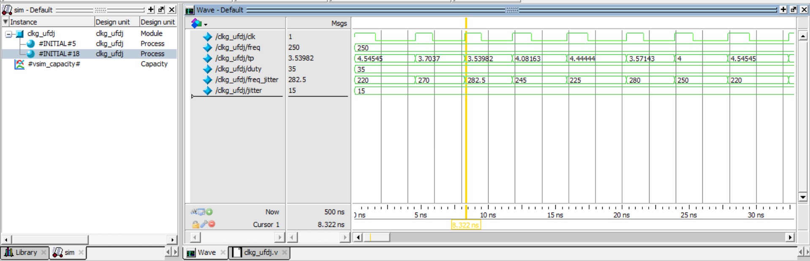

# User-Defined Clock Generation with Variable Duty Cycle and Frequency Jitter using Verilog HDL

<p align="center">
  <b>Verilog HDL | ModelSim 2020.1 | GVim</b>
</p>

---

## 1. Project Overview

This project implements a **User-Defined Clock Generator with Variable Duty Cycle and Frequency Jitter** using Verilog Hardware Description Language (HDL).

The design allows users to specify three runtime parameters:

- Clock frequency
- Duty cycle
- Frequency jitter percentage

Unlike a conventional clock generator that produces a constant-frequency clock, this design introduces randomized frequency variation in every clock cycle. The clock period is recalculated for each cycle based on a randomly generated frequency value within the specified jitter range.

The duty-cycle percentage remains fixed at the user-defined value, while the HIGH and LOW durations vary according to the changing clock period.

The design is simulated using ModelSim 2020.1 to observe the effect of frequency variation on the generated clock waveform.

## 2. Objectives

- To design a user-defined clock generator using Verilog HDL.
- To implement variable duty-cycle control.
- To introduce frequency jitter using the Verilog random-number function.
- To understand cycle-to-cycle frequency variation.
- To calculate the corresponding clock period, HIGH time, and LOW time.
- To simulate and analyze the generated clock waveform using ModelSim.

## 3. Tools and Technologies Used

| Tool / Technology | Description |
|:---|:---|
| Verilog HDL | Hardware Description Language |
| ModelSim 2020.1 | HDL compilation and simulation |
| GVim | Verilog source-code editor |
| Windows / Linux | Development environment |

## 4. Repository Structure

```text
User-Defined-Clock-Generation-with-Jitter/
│
├── clkg_ufdj.v
├── run.do
├── Waveform.png
└── README.md
```

| File Name | Description |
|:---|:---|
| `clkg_ufdj.v` | Verilog HDL source code |
| `run.do` | ModelSim compilation and simulation script |
| `Waveform.png` | ModelSim simulation waveform |
| `README.md` | Project documentation |

## 5. Design Specifications

The following parameters are used in the simulation:

| Parameter | Value |
|:---|---:|
| Nominal Clock Frequency | 250 MHz |
| Duty Cycle | 35% |
| Frequency Jitter | ±15% |
| Simulation Duration | 500 ns |
| Time Scale | 1 ns / 1 ps |

### 5.1 Frequency Variation Range

The nominal frequency is 250 MHz, with a frequency variation of ±15%.

Minimum frequency:

\[
f_{min}=250\times(1-0.15)
\]

\[
\boxed{f_{min}=212.5\ MHz}
\]

Maximum frequency:

\[
f_{max}=250\times(1+0.15)
\]

\[
\boxed{f_{max}=287.5\ MHz}
\]

Therefore, the randomized frequency varies between 212.5 MHz and 287.5 MHz.

## 6. Theoretical Background

### 6.1 Clock Frequency

Clock frequency represents the number of complete clock cycles occurring per second.

\[
f=\frac{1}{T}
\]

Where:

- \(f\) = Clock frequency
- \(T\) = Clock period

For a nominal frequency of 250 MHz:

\[
T=\frac{1}{250\times10^6}
\]

\[
\boxed{T=4\ ns}
\]

### 6.2 Duty Cycle

Duty cycle represents the percentage of one clock period during which the clock signal remains HIGH.

\[
Duty\ Cycle=\frac{T_{ON}}{T}\times100
\]

The HIGH duration is:

\[
T_{ON}=\frac{Duty\ Cycle}{100}\times T
\]

The LOW duration is:

\[
T_{OFF}=T-T_{ON}
\]

For a 35% duty cycle and a nominal period of 4 ns:

\[
T_{ON}=0.35\times4
\]

\[
\boxed{T_{ON}=1.4\ ns}
\]

\[
T_{OFF}=4-1.4
\]

\[
\boxed{T_{OFF}=2.6\ ns}
\]

### 6.3 Frequency Jitter

Frequency jitter in this project is represented by cycle-to-cycle variation in the generated clock frequency.

A random frequency variation is generated using the Verilog system function:

```verilog
$urandom_range()
```

The randomized frequency is calculated as:

\[
f_{jitter}=f_{nominal}\times\frac{R}{100}
\]

Where:

- \(f_{jitter}\) = Randomized frequency for the current cycle
- \(f_{nominal}\) = User-defined nominal frequency
- \(R\) = Random integer between \(100-J\) and \(100+J\)
- \(J\) = User-defined jitter percentage

For a nominal frequency of 250 MHz and 15% jitter:

\[
R=85\ \text{to}\ 115
\]

\[
f_{jitter}=250\times\frac{85\ \text{to}\ 115}{100}
\]

\[
\boxed{f_{jitter}=212.5\ \text{to}\ 287.5\ MHz}
\]

The clock period is recalculated for every cycle:

\[
T_{jitter}=\frac{1000}{f_{jitter}}
\]

Here, frequency is expressed in MHz and time period in ns.

## 7. Working Principle

The clock generation process follows these steps:

1. Read the nominal frequency from the user.
2. Read the duty-cycle percentage.
3. Read the frequency-jitter percentage.
4. Generate a random frequency variation for the current clock cycle.
5. Calculate the corresponding clock period.
6. Generate the HIGH duration according to the specified duty cycle.
7. Generate the LOW duration using the remaining clock period.
8. Repeat the process to generate a clock signal with cycle-to-cycle frequency variation.
9. Stop the simulation after 500 ns.

The frequency is randomized independently for each clock cycle, while the duty-cycle percentage remains fixed.

## 8. Verilog HDL Implementation

### 8.1 Source Code: `clkg_ufdj.v`

```verilog
`timescale 1ns/1ps

module clkg_ufdj;

reg clk;
real freq,tp,duty,freq_jitter,jitter;

initial begin

    $value$plusargs("freq=%f",freq);
    $value$plusargs("duty=%f",duty);
    $value$plusargs("jitter=%f",jitter);

    clk = 0; // initializing clk

    forever begin

        freq_jitter=freq*
        $urandom_range(100-jitter,100+jitter)/100;

        tp=(1000/freq_jitter); // tp in ns

        clk=1;
        #(duty*tp/100.0);

        clk=0;
        #((100-duty)*tp/100.0);

    end

end

initial begin
    #500;
    $finish;
end

endmodule
```

### 8.2 Code Explanation

| Verilog Statement | Description |
|:---|:---|
| `timescale 1ns/1ps` | Defines simulation time unit and precision |
| `reg clk` | Declares the clock signal |
| `real freq,tp,duty,freq_jitter,jitter` | Declares real-valued variables |
| `$value$plusargs()` | Reads runtime parameters from ModelSim |
| `$urandom_range()` | Generates a random integer within the specified range |
| `freq_jitter` | Stores the randomized frequency for each cycle |
| `tp = 1000/freq_jitter` | Calculates the clock period in ns |
| `#(duty*tp/100.0)` | Controls the HIGH duration |
| `#((100-duty)*tp/100.0)` | Controls the LOW duration |
| `$finish` | Terminates the simulation |

## 9. ModelSim Simulation Setup

### 9.1 Simulation Script: `run.do`

The following commands are used to compile and simulate the Verilog design.

```tcl
# compilation
vlog clkg_ufdj.v -l comp.log

# elaboration
vsim -voptargs=+acc clkg_ufdj +freq=250 +duty=35 +jitter=15

# addwave
add wave sim:/clkg_ufdj/*

# run
run -all
```

### 9.2 Runtime Parameter Description

| Parameter | Value | Description |
|:---|---:|:---|
| `+freq=250` | 250 MHz | Nominal clock frequency |
| `+duty=35` | 35% | Clock duty cycle |
| `+jitter=15` | ±15% | Frequency variation percentage |

These parameters can be modified directly in the ModelSim simulation command to investigate different clock configurations.

### 9.3 Simulation Command Description

| Command | Function |
|:---|:---|
| `vlog` | Compiles the Verilog source file |
| `vsim` | Loads the design for simulation |
| `+freq=250` | Provides nominal frequency |
| `+duty=35` | Provides duty-cycle percentage |
| `+jitter=15` | Provides frequency-jitter percentage |
| `add wave` | Adds design signals to the waveform window |
| `run -all` | Executes the simulation |

## 10. Simulation Results

The Verilog design was simulated using ModelSim 2020.1 with the following runtime parameters:

| Parameter | Value |
|:---|---:|
| Nominal Frequency | 250 MHz |
| Duty Cycle | 35% |
| Frequency Jitter | ±15% |
| Simulation Duration | 500 ns |
| Time Scale | 1 ns / 1 ps |

### 10.1 ModelSim Simulation Waveform

The following waveform shows the generated clock signal along with its nominal frequency, calculated time period, randomized frequency, and jitter parameter.

<p align="center">
  
</p>

<p align="center">
  <b>Figure 1: ModelSim Simulation Waveform showing variable clock frequency and frequency jitter.</b>
</p>

### 10.2 Simulation Signal Analysis

| Signal | Observed Behaviour |
|:---|:---|
| `clk` | Clock signal with varying cycle duration |
| `freq` | Nominal frequency of 250 MHz |
| `tp` | Clock period recalculated for every cycle |
| `duty` | Fixed duty-cycle value of 35% |
| `freq_jitter` | Randomized frequency for each clock cycle |
| `jitter` | Frequency variation setting of 15% |

### 10.3 Observed Frequency and Time Period

The waveform displays different randomized frequency values during simulation.

| Randomized Frequency | Calculated Time Period |
|---:|---:|
| 220 MHz | 4.545 ns |
| 270 MHz | 3.704 ns |
| 282.5 MHz | 3.540 ns |
| 245 MHz | 4.082 ns |
| 225 MHz | 4.444 ns |
| 280 MHz | 3.571 ns |
| 250 MHz | 4.000 ns |
| 220 MHz | 4.545 ns |

### 10.4 Example Timing Calculation

Consider a randomized frequency of 282.5 MHz.

The clock period is:

\[
T=\frac{1000}{282.5}
\]

\[
T=3.5398\ ns
\]

For a 35% duty cycle:

HIGH duration:

\[
T_{ON}=0.35\times3.5398
\]

\[
\boxed{T_{ON}\approx1.239\ ns}
\]

LOW duration:

\[
T_{OFF}=0.65\times3.5398
\]

\[
\boxed{T_{OFF}\approx2.301\ ns}
\]

This demonstrates how frequency variation affects the clock period and the corresponding HIGH and LOW durations.

### 10.5 Simulation Observations

- The nominal clock frequency is specified as 250 MHz.
- Random frequency variation is introduced for every clock cycle.
- The randomized frequency varies within the range of 212.5 MHz to 287.5 MHz.
- The clock period changes according to the randomized frequency.
- The duty-cycle percentage remains fixed at 35%.
- Both HIGH and LOW durations change as the clock period varies.
- The waveform demonstrates cycle-to-cycle frequency variation.

## 11. Comparison: Conventional Clock vs. Jitter-Based Clock

| Parameter | Conventional Clock | Jitter-Based Clock |
|:---|:---|:---|
| Frequency | Constant | Randomly varied |
| Clock Period | Constant | Changes every cycle |
| Duty Cycle | Fixed or configurable | Fixed at user-defined value |
| HIGH Duration | Constant for fixed duty | Changes with period |
| LOW Duration | Constant for fixed duty | Changes with period |
| Frequency Jitter | Not modelled | Introduced through randomization |

## 12. Applications

The concepts demonstrated in this project are useful for understanding:

- Clock generation and timing control.
- Clock frequency variation.
- Jitter-like effects in digital systems.
- Clock-related verification and testbench development.
- Timing behaviour of digital circuits.
- Simulation of non-ideal clock sources.

## 13. Learning Outcomes

Through this project, I explored:

- Runtime parameter passing in Verilog HDL.
- Clock generation using procedural blocks.
- Variable duty-cycle implementation.
- Random-number generation using `$urandom_range()`.
- Cycle-to-cycle frequency variation.
- Clock period calculation and timing analysis.
- ModelSim compilation, simulation, and waveform analysis.

## 14. Conclusion

A user-defined clock generator with variable duty cycle and frequency jitter was designed and simulated using Verilog HDL and ModelSim 2020.1.

The design demonstrates how randomized frequency variation affects the clock period and corresponding HIGH and LOW durations while maintaining a fixed duty-cycle percentage.

This project provided practical understanding of clock generation, frequency variation, randomization, and timing analysis in digital design.

---

**Project Category:** Digital Design and Functional Simulation

**Tools Used:** Verilog HDL | ModelSim 2020.1 | GVim
